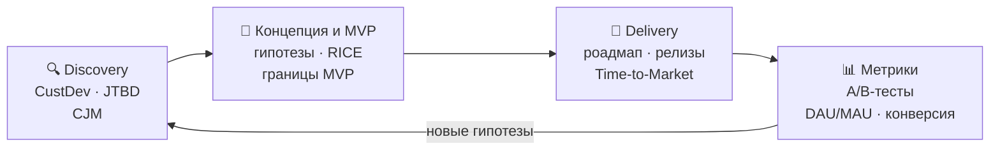
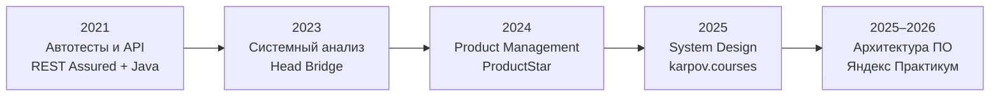

<h1>Евгений Самойлов</h1>

**Delivery Manager · Руководитель ИТ-проектов · Product Owner** 
X5 Tech, ранее Сбер · Москва

---

### 👋 Обо мне

Развиваю цифровые продукты на стыке бизнеса и технологий. Бэкграунд системного аналитика, последние 6 лет — в крупных компаниях: **X5 Tech** и **Сбер**. Опираюсь на метрики: гипотеза → эксперимент → решение.

- 🛒 **Сейчас** — в X5 Tech веду портфель цифровых HR-продуктов: платформа Support-HR (134 тыс. DAU), сервис командировок, курьерская доставка документов. Команда до 20 человек: аналитики, backend, frontend, QA, DevOps.
- 🛠️ **Технический бэкграунд** — проектирую API и интеграции, разбираюсь в Kafka, BPMN и SQL, писал автотесты на Java и парсеры на Python. С разработчиками говорю на одном языке.
- 🤖 **ИИ в работе** — запустил ИИ-бота для HR-процессов, внедрил разработку с ИИ-ассистентами.
- 🥋 **Вне работы** — джиу-джитсу.

### 📊 Результаты в цифрах

<picture>
  <source media="(prefers-color-scheme: dark)" srcset="assets/kpi-dark.svg"/>
  
</picture>

<b>Подробнее: что сделал и к чему это привело</b>

 

| Что сделал | Результат | Где |
|---|---|---|
| Руководил переводом интеграционной платформы на событийную архитектуру (Kafka) | до 700 тыс. событий в сутки, нагрузка на инфраструктуру **−30%** при сохранении доступности **99,99%** | X5 Tech |
| Запустил систему PostTracking | подключение новых почтовых и курьерских операторов в **4 раза** быстрее, трудозатраты команды в **10 раз** меньше | X5 Tech |
| Организовал запуск ИИ-бота для HR-процессов | автоматизировано **20%** типовых HR-операций | X5 Tech |
| Инициировал внутренний продукт Fast Report (аналог Jam.dev): концепция, требования, MVP | MVP для автоматизации баг-репортов и ускорения работы QA с разработкой | X5 Tech |
| Переработал пользовательский путь витрины новостроек (7+ млн MAU) по итогам CJM, CustDev и анализа метрик | конверсия **+40%** | Сбер |
| Внедрил компьютерное зрение (ML) для оценки фото объектов | переходы на страницы ЖК **+30%** | Сбер |
| Сделал MVP Python-парсеров для анализа рынка недвижимости | трудозатраты дата-аналитиков в **2 раза** меньше | Сбер |
| Участвовал в миграции маркетинговых кампаний с SAS на jBPM | стоимость сопровождения **−5%**, производительность **+20%** | Сбер |
| Спроектировал интеграцию сайта компании с 1С | трудозатраты договорного отдела **−40%** | ЭкоСтройРесурс |

### 🔄 Как я развиваю продукт

**На практике:**
- 🔍 **Discovery** — по итогам CJM, CustDev и анализа метрик переработал пользовательский путь витрины новостроек в Сбере: конверсия выросла на 40%.
- 🎯 **Концепция и MVP** — инициировал в X5 Tech внутренний продукт Fast Report для баг-репортов: сформировал концепцию и требования, организовал работу команды, довёл до MVP.
- 🚀 **Delivery** — веду роадмап на 6–12 месяцев, backlog и релизы кросс-функциональной команды до 20 человек.
- 📊 **Метрики** — в Сбере настраивал Firebase Analytics и Sentry, проводил A/B-тесты. В X5 Tech контролирую продуктовые и операционные KPI: DAU/MAU, Time-to-Market, SLA, доступность, ROI, FTE.

### 💼 Опыт

| Период | Компания | Роль |
|---|---|---|
| 2023 — сейчас | **X5 Tech** | Руководитель ИТ-проектов / Delivery Manager |
| 2020 — 2023 | **Сбер** | Руководитель ИТ-проектов / Системный аналитик |
| 2019 — 2020 | ЭкоСтройРесурс | Бизнес-аналитик |
| 2012 — 2019 | B2B и B2C компании | От консультанта по продажам до начальника договорного отдела |

### 🚀 Проекты

**🏗️ [CinemaAbyss](https://github.com/Samoiloff90/architecture-pro-cinemaabyss)** — учебный проект курса «Архитектура ПО» в Яндекс Практикуме. Вынос микросервисов из монолита по паттерну Strangler Fig, API Gateway с процентной маршрутизацией трафика, событийное взаимодействие через Kafka, развёртывание в Kubernetes через Helm, CI/CD на GitHub Actions. 
`Go` `Kafka` `Kubernetes` `Helm` `GitHub Actions`

<b>🧪 Ранние репозитории (2021–2022)</b>

 

Время, когда я учился автоматизации тестирования и вёрстке: UI-автотесты на Selenide, API-тесты на REST Assured с отчётами Allure, сборки в Jenkins, мобильные автотесты под Android, учебные сайты на HTML/CSS/JS. Оставил их как историю обучения.

### 🌱 Развитие

Высшее образование — Российский государственный торгово-экономический университет (Самарский институт), торговое дело и маркетинг, 2016.

### 🧰 Инструменты

**Продукт и управление:** Agile · Scrum · SAFe · Lean · Product Discovery · CustDev · JTBD · CJM · RICE

  

**Аналитика и мониторинг:** A/B-тесты · SQL · продуктовые метрики

 

**Проектирование:** REST API · BPMN · UML · Kafka

  

**Стек моих команд:**

---

Полное резюме — на [samoiloff90.github.io](https://samoiloff90.github.io)

Написать проще всего в [Telegram](https://t.me/Samoiloff90) или на [i@samoiloff90.ru](mailto:i@samoiloff90.ru)

